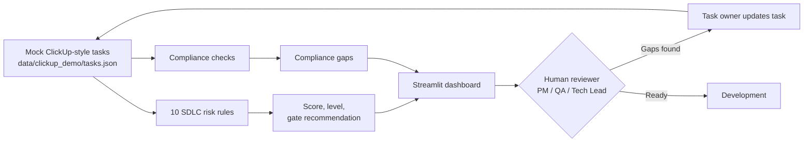

# ClickUp SDLC Risk Gatekeeper

**Author:** Oren Salami · **Category:** Project Planning & Delivery

A readiness check for software tasks *before* development starts. It reviews ClickUp-style tasks for missing acceptance criteria, QA plans, Definition of Done, security, architecture, compliance, and dependency gaps, then gives each task an explainable risk score and a recommended next step for a human reviewer.

This is a learning and portfolio project, not a commercial product. It runs entirely on local mock data.

---

## Why This Project

Tasks often enter a sprint with gaps: vague acceptance criteria, no test plan, a security-sensitive change with no threat model, or a blocked dependency. Finding those gaps during planning is cheap; finding them in production is not. This project explores how delivery planning can make those risks visible early and consistently.

## What It Does

- Runs **10 deterministic rules** over each task (acceptance criteria, QA notes, DoD, security, AI/LLM readiness, architecture, critical-priority scope, dependencies, compliance evidence, due dates)
- Produces a **risk score (0–100)**, **risk level** (Low / Medium / High / Critical), **recommended gate decision**, **findings**, and **recommendations**
- Flags **GDPR, PCI-DSS, HIPAA, SOX, and general security** evidence gaps in a separate compliance view
- Shows everything in a **Streamlit dashboard** with sprint, status, risk, and gate filters

Recommended gate decisions: Approved for Development · Needs Clarification · Requires QA Review · Requires Security Review · Requires Architecture Review · Blocked. Rules, weights, and workflow: [docs/PROJECT_OVERVIEW.md](docs/PROJECT_OVERVIEW.md).

## How It Works



The score is the sum of triggered rule weights, capped at 100. The human review step happens outside the app; the dashboard does not record decisions.

## Project in Pictures

The images below are **screenshots of a manually built ClickUp workspace** (an external service) that mirrors the project's workflow. They are not screenshots of this app, and the workspace is not populated by this code. See [docs/DEMO_AND_OPERATIONS.md](docs/DEMO_AND_OPERATIONS.md#images).

| Workspace lists and progress | Risk review queues |
|---|---|
|  |  |

## Example Workflow

Using demo task **TASK-005 — Implement payment processing integration with Stripe**:

1. The task has no acceptance criteria, QA notes, or confirmed DoD, is marked critical with a short scope, and is tagged `pci` with no compliance evidence.
2. Rules 001, 002, 003, 006, 007, and 009 fire (plus RULE-010 once its due date has passed); the score caps at **100 (Critical)**.
3. The recommended gate is **Requires Security Review**, and the compliance view shows a PCI-DSS evidence gap.
4. A reviewer reads the findings, the owner adds the missing details, and the task is reviewed again.

All 20 demo tasks are listed in [docs/DEMO_AND_OPERATIONS.md](docs/DEMO_AND_OPERATIONS.md#demo-scenarios).

## Architecture at a Glance

| Part | Location | Status |
|---|---|---|
| Mock data loader (dashboard data source) | `src/core/clickup_adapter.py` | Working, default |
| Rules, scoring, compliance, reports | `src/core/` | Working |
| Dashboard | `app/streamlit_app.py` | Working |
| Read-only ClickUp API client | `src/integrations/clickup_api_client.py` | Optional; not used by the dashboard |
| Write-back (comments, labels, status) | API client methods | Not implemented (`NotImplementedError`) |

Pure Python, no database or external services. Details: [docs/ARCHITECTURE.md](docs/ARCHITECTURE.md).

## Run Locally

```bash
pip install streamlit pytest requests python-dotenv
streamlit run app/streamlit_app.py      # http://localhost:8501
```

No credentials are needed. Docker, configuration, and troubleshooting are covered in [docs/DEMO_AND_OPERATIONS.md](docs/DEMO_AND_OPERATIONS.md). The Docker build currently needs a `requirements.txt`, which the repository does not have.

## Human Review & Boundaries

- Outputs are **advisory**. The engine recommends; people decide.
- Rules use **keyword and field-completeness checks**, so they can miss real risks or flag false ones.
- The engine reads task metadata only — not code, attachments, or links.
- `RULE-010` compares due dates to today's date. All demo due dates fall in June–July 2026, so it now flags every demo task as overdue, which raises scores.
- Not a substitute for formal security, legal, or compliance review.

More: [docs/GOVERNANCE_AND_VALIDATION.md](docs/GOVERNANCE_AND_VALIDATION.md)

## Documentation & Validation

| Document | Covers |
|---|---|
| [PROJECT_OVERVIEW.md](docs/PROJECT_OVERVIEW.md) | Problem, purpose, capabilities, rules, workflow, example |
| [ARCHITECTURE.md](docs/ARCHITECTURE.md) | Components, technologies, data flow, integration status |
| [DEMO_AND_OPERATIONS.md](docs/DEMO_AND_OPERATIONS.md) | Install, startup, configuration, demo tasks, images, troubleshooting |
| [GOVERNANCE_AND_VALIDATION.md](docs/GOVERNANCE_AND_VALIDATION.md) | Human oversight, boundaries, security, testing, limitations, future ideas |

Tests: `pytest` (64 tests, offline, no credentials).

