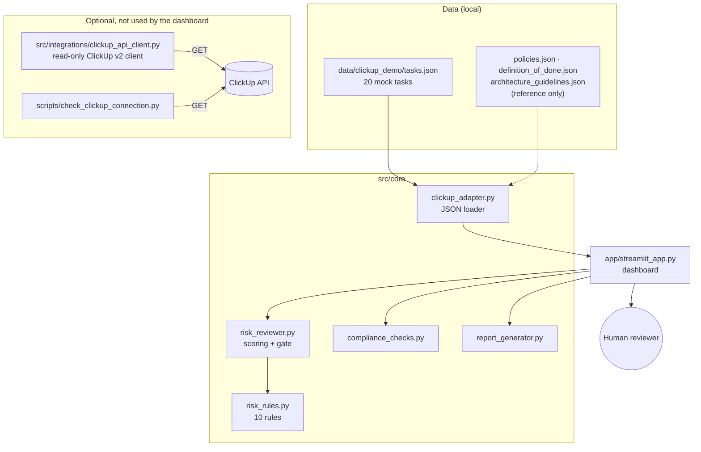

# Architecture

The project is a small, flat Python application: a rule engine, a JSON data loader, and a Streamlit dashboard. It has no database, message queue, web API, or cloud dependency.

## Architecture diagram



## Components

| Component | Responsibility |
|---|---|
| `src/core/clickup_adapter.py` | Loads tasks and reference files from `data/clickup_demo/`. This is the dashboard's only data source. Its write-back functions are placeholders that raise `NotImplementedError`. |
| `src/core/risk_rules.py` | Keyword lists and one function per rule. Each returns a finding (rule ID, severity, weight, text, recommendation) or nothing. Keywords match on word boundaries. |
| `src/core/risk_reviewer.py` | `RiskReviewer.review(task)` runs every rule, sums weights (capped at 100), assigns a risk level, and picks the recommended gate. |
| `src/core/compliance_checks.py` | Checks GDPR, PCI-DSS, HIPAA, SOX, and general security profiles: trigger keywords in title/description/tags, evidence keywords in security, architecture, or QA notes. Uses plain substring matching. |
| `src/core/report_generator.py` | Flattens each review into a display record and builds summary counts by risk level and gate. |
| `app/streamlit_app.py` | One-file dashboard with four tabs (Task Risk Dashboard, Task Detail, Compliance View, About) and sidebar filters for sprint, status, risk level, and gate. Read-only. |
| `src/integrations/base.py` | `TaskClient` protocol: `fetch_tasks()` and `fetch_task_by_id()`. |
| `src/integrations/mock_client.py` | `TaskClient` implementation that wraps the JSON loader. Used in tests. |
| `src/integrations/clickup_api_client.py` | Read-only ClickUp v2 client. Not called by the dashboard. |
| `scripts/check_clickup_connection.py` | Read-only command-line check of ClickUp connectivity and workspace structure. |

## Technologies

| Layer | Technology |
|---|---|
| Language | Python (the Docker image uses 3.11) |
| UI | Streamlit |
| Engine | Plain Python: `re`, `dataclasses`, `datetime` |
| Data | JSON files |
| HTTP (optional client only) | `requests` |
| `.env` loading (connection script only) | `python-dotenv` (optional) |
| Tests | pytest, `unittest.mock` |
| Packaging | Dockerfile, Docker Compose |

## Data flow

```text
tasks.json
  → clickup_adapter.load_tasks()           list of task dicts
  → RiskReviewer.review(task)              RiskReviewResult (score, level, gate, findings, recommendations)
  → generate_task_report(task, result)     display record
  → generate_summary_report(records)       project counts
  → Streamlit dashboard                    filters, tabs, compliance view (check_compliance per task)
```

The dashboard loads and reviews all tasks once and caches the result with `@st.cache_data`. RULE-010 uses `date.today()`, so the same data can score differently on different days.

### Task fields used

`task_id`, `title`, `description`, `status`, `priority`, `assignee`, `sprint`, `tags`, `acceptance_criteria`, `definition_of_done_status`, `security_notes`, `architecture_notes`, `qa_notes`, `dependencies`, and `due_date` (`YYYY-MM-DD`).

### Reference files

The adapter can load `policies.json`, `definition_of_done.json`, and `architecture_guidelines.json`, and tests cover that. These files do **not** drive the engine. Thresholds and weights are Python constants in `risk_rules.py` and `risk_reviewer.py`, so editing the JSON changes nothing.

## Integration status

| Item | Actual status |
|---|---|
| Dashboard data source | Local JSON only. Setting `CLICKUP_API_TOKEN` does not change what it shows. |
| `ClickUpApiClient.fetch_tasks()` / `fetch_task_by_id()` | Implemented and read-only. Calls `GET /list/{id}/task` and `GET /task/{id}` with the token in the `Authorization` header. |
| Behavior without configuration | With no token, no list IDs, or no `requests` installed: returns `[]` / `None`. |
| Error handling | HTTP errors raise `RuntimeError` with a message that never includes the token. A 404 on a single task returns `None`. |
| Pagination, rate limiting, retries | Not implemented. Only the first page of tasks per list is fetched. |
| `.env` loading | Only the connection script loads `.env` (if `python-dotenv` is installed). The client reads `os.environ` directly. |
| Field mapping (`_map_task`) | Reads ClickUp custom fields named `Acceptance Criteria`, `QA Notes`, `Security Notes`, `Architecture Notes`, `DoD Status`, and `Sprint`. Not validated against live data. ClickUp returns `due_date` as a millisecond timestamp, which RULE-010 cannot parse, so the rule would skip live tasks. |
| Write-back (`post_review_comment`, `set_risk_label`, `update_task_status`) | Not implemented. Raises `NotImplementedError` in both the client and the adapter. |
| Webhooks, sync, other tools (Jira, Linear, etc.) | Not implemented. A new tool would need a client that satisfies `TaskClient`. |

Connecting the dashboard to live data would mean changing `app/streamlit_app.py` to use the API client. This has deliberately not been done, so the demo runs anywhere without credentials.

## Design choices

- **Deterministic rules, not an LLM:** transparent, fast, testable, and offline. An LLM layer could be added later but is out of scope.
- **Flat JSON data:** easy to read and edit, and enough for 20 tasks.
- **One core package:** the project is small enough that more layers would only add indirection.
