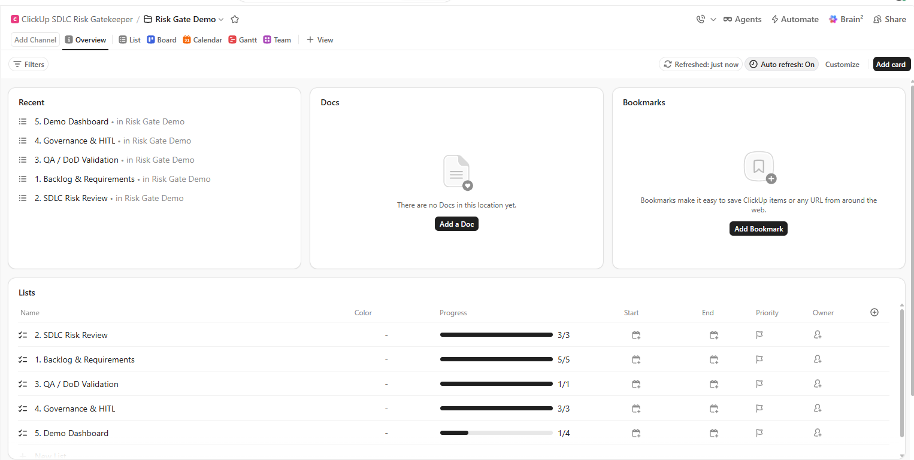
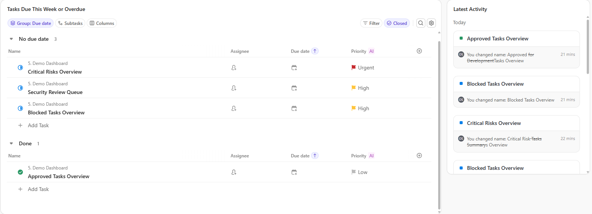
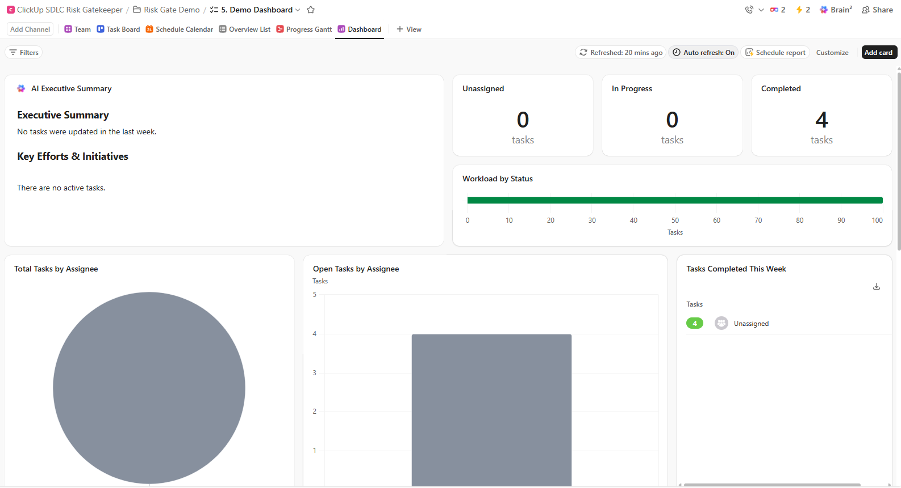

# Demo and Operations

## Installation

The repository has no `requirements.txt` at the moment. Install the packages the code imports directly:

```bash
python -m venv .venv
# Windows: .venv\Scripts\activate    macOS/Linux: source .venv/bin/activate
pip install streamlit pytest requests python-dotenv
```

| Package | Needed for |
|---|---|
| `streamlit` | The dashboard (required) |
| `pytest` | Running the tests |
| `requests` | The optional ClickUp client and connection script. Also needed to run the full test suite, which patches `requests` |
| `python-dotenv` | Optional: lets the connection script read a local `.env` file |

Verified locally with Python 3.12.10, Streamlit 1.60.0, pytest 8.3.4, and requests 2.34.2.

## Local startup

From the repository root:

```bash
streamlit run app/streamlit_app.py
```

Open http://localhost:8501. No credentials, network access, or configuration are needed. The dashboard always uses `data/clickup_demo/tasks.json`.

To use another port: `streamlit run app/streamlit_app.py --server.port 8502`.

## Docker startup

```bash
docker compose up --build
```

Compose builds the image, publishes port 8501, and mounts `./data` into the container so you can edit the demo data without rebuilding. The image runs as a non-root user, and `.dockerignore` keeps `.env` out of it.

> **Current issue:** the `Dockerfile` runs `COPY requirements.txt ./` and `pip install -r requirements.txt`. That file is missing, so the build fails at this step until a `requirements.txt` is added back. Local startup is not affected.

## Configuration

The dashboard needs no configuration. Environment variables are only for the **optional** read-only ClickUp client and the connection-check script. `.env.example` is the template. Copy it to `.env`, which git and Docker both ignore, and never commit real values.

| Variable | Used by | Purpose |
|---|---|---|
| `CLICKUP_API_TOKEN` | Client, script | Personal API token. Required by the script |
| `CLICKUP_TEAM_ID` | Script | Workspace ID. Required by the script |
| `CLICKUP_SPACE_ID`, `CLICKUP_FOLDER_ID` | Script | Optional: list folders and lists |
| `CLICKUP_LIST_BACKLOG_REQUIREMENTS_ID`, `CLICKUP_LIST_SDLC_RISK_REVIEW_ID`, `CLICKUP_LIST_QA_DOD_VALIDATION_ID`, `CLICKUP_LIST_GOVERNANCE_HITL_ID`, `CLICKUP_LIST_DEMO_DASHBOARD_ID` | Client, script | Lists to read tasks from |
| `CLICKUP_INTEGRATION_MODE` | Script (display only) | Printed by the script; changes no behavior |
| `CLICKUP_USE_MOCK_FALLBACK` | Nothing | In the template but not read by any code |

Run the read-only connection check:

```bash
python scripts/check_clickup_connection.py
```

The script prints the workspace's spaces, folders, lists, and task names, statuses, and priorities. It never prints the token and performs no writes. If required variables are missing, it says which ones and exits.

## Demo scenarios

The 20 fictional tasks in `data/clickup_demo/tasks.json` cover every rule and every gate. The table shows engine results **without RULE-010** (the due-date rule), because those stay stable over time.

| Task | Title | Score | Level | Rules (excluding RULE-010) | Recommended gate |
|---|---|---|---|---|---|
| TASK-001 | OAuth2 user authentication | 80 | Critical | 001, 002, 003, 004 | Requires Security Review |
| TASK-002 | AI product recommendation engine | 65 | High | 002, 003, 005 | Requires Security Review |
| TASK-003 | Database schema migration | 40 | Medium | 003, 006 | Requires Architecture Review |
| TASK-004 | Fix typo on About page | 0 | Low | — | Approved for Development |
| TASK-005 | Stripe payment integration | 100 | Critical | 001, 002, 003, 006, 007, 009 | Requires Security Review |
| TASK-006 | Unit tests for order service | 0 | Low | — | Approved for Development |
| TASK-007 | Deploy Sprint 4 to production | 95 | Critical | 001, 002, 003, 006, 007 | Requires Architecture Review |
| TASK-008 | GDPR data deletion endpoint | 50 | Medium | 003, 009 | Requires Security Review |
| TASK-009 | Refactor REST endpoints to GraphQL | 65 | High | 003, 006, 008 | Blocked |
| TASK-010 | Rate limiting on API gateway | 0 | Low | — | Approved for Development |
| TASK-011 | Admin dashboard for accounts | 30 | Medium | 002, 003 | Requires QA Review |
| TASK-012 | CI/CD pipeline with GitHub Actions | 40 | Medium | 003, 006 | Requires Architecture Review |
| TASK-013 | LLM content moderation | 85 | Critical | 001, 002, 003, 005 | Requires Security Review |
| TASK-014 | Password hashing MD5 → bcrypt | 0 | Low | — | Approved for Development |
| TASK-015 | Search feature | 70 | High | 001, 002, 003, 007 | Requires QA Review |
| TASK-016 | Checkout performance testing | 0 | Low | — | Approved for Development |
| TASK-017 | Third-party analytics SDK | 35 | Medium | 001, 003 | Needs Clarification |
| TASK-018 | Encryption at rest for PII | 100 | Critical | 001, 002, 003, 004, 006, 009 | Requires Security Review |
| TASK-019 | Fix mobile image loading | 0 | Low | — | Approved for Development |
| TASK-020 | Kubernetes for microservices | 95 | Critical | 001, 002, 003, 006, 007 | Requires Architecture Review |

Scenarios worth opening in the **Task Detail** tab:

- **TASK-009:** a high-severity dependency finding overrides every other gate and gives **Blocked**.
- **TASK-015:** critical priority with a one-word scope. The missing QA plan routes it to QA review ahead of clarification.
- **TASK-002 and TASK-013:** AI features with none of the six AI readiness dimensions documented.
- **TASK-018:** one task that collects security, architecture, and compliance gaps. The **Compliance View** flags GDPR, PCI-DSS, and general security.
- **TASK-010:** approved by the rules, but still listed in the Compliance View with a general-security evidence gap, because the compliance checks use their own keywords. A reviewer should look at it.

**Current dates:** every demo due date falls in June–July 2026. After those dates, RULE-010 adds 20 points to every task (capped at 100). The dashboard then shows higher scores and levels than the table above (for example, 13 tasks are High or Critical instead of 9), but the recommended gates stay the same.

## Images

These are **screenshots of an external service**: a ClickUp workspace that was set up by hand to illustrate the workflow, with lists for Backlog & Requirements, SDLC Risk Review, QA / DoD Validation, Governance & HITL, and a Demo Dashboard. They are not screenshots of this project's dashboard, and this code did not create or fill the workspace. No application screenshots are included.


*ClickUp folder overview: the five demo lists and their progress.*


*ClickUp dashboard items for critical risks, the security review queue, blocked tasks, and approved tasks, ordered by priority flag.*


*ClickUp dashboard view for the demo folder. The "AI Executive Summary" card is a built-in ClickUp feature, not part of this project.*

## Troubleshooting

| Symptom | Cause and fix |
|---|---|
| `pip install -r requirements.txt` fails | The file is missing. Use the `pip install` command above. |
| `docker compose up --build` fails at `COPY requirements.txt` | Same cause. Add a `requirements.txt` back, or run locally. |
| `ModuleNotFoundError: No module named 'streamlit'` | Activate the virtual environment and install the packages. |
| Port 8501 is already in use | Stop the other process, or add `--server.port 8502`. |
| Scores are higher than in the table above | RULE-010 is flagging past due dates (see above). This is expected. |
| Edits to `tasks.json` don't appear | Results are cached. Use **Clear cache** in the Streamlit menu, or restart the app. |
| Setting `CLICKUP_API_TOKEN` doesn't show live tasks | By design: the dashboard always uses local JSON. |
| Connection script: "Missing required environment variables" | Set `CLICKUP_API_TOKEN` and `CLICKUP_TEAM_ID` in `.env`, and install `python-dotenv` so the script can read it. |
| Connection script: HTTP 401 or 403 | The token is wrong or lacks access to the workspace. |
| Connection script: SSL error on Windows | Follow the script's hint (`pip install python-certifi-win32`, or set `REQUESTS_CA_BUNDLE`). |
