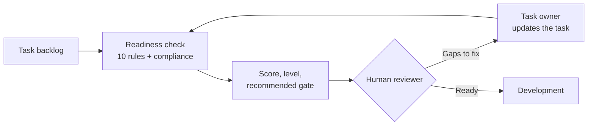

# Project Overview

**ClickUp SDLC Risk Gatekeeper** · Author: Oren Salami · Category: Project Planning & Delivery

## The problem

Software tasks often enter a sprint before they are ready. Common gaps:

- Acceptance criteria are missing or too vague to test
- There is no QA plan, and the Definition of Done (DoD) is not confirmed
- A security-sensitive change has no security notes or threat model
- An AI/LLM feature has no evaluation, fallback, or guardrail plan
- An architecture-impacting change has had no design review
- A compliance-related task (GDPR, PCI-DSS, HIPAA, SOX) has no documented evidence
- A task depends on work that is still blocked

These gaps are cheap to fix during planning and expensive to fix after release.

## Purpose

The project explores how delivery planning can make these risks visible **before development starts**. It applies a consistent readiness check to every task and gives a human reviewer a clear, explainable summary of what is missing.

It is a learning and portfolio project, not a commercial product. It runs on local mock data.

## Value

- **Risk visibility:** every task gets a score, a level, and a reason, so the riskiest work is easy to spot
- **Consistency:** the same checks run on every task, which reduces what gets missed under sprint pressure
- **Explainability:** each finding comes from a named rule with a fixed weight, so nothing is a black box
- **Delivery support:** each finding comes with a concrete recommendation, and the recommended gate points to who should look next (QA, security, architecture)

## Capabilities

| Capability | Status |
|---|---|
| 10 deterministic risk rules per task | Working |
| Risk score (0–100), level, and recommended gate decision | Working |
| Findings and recommendations for each triggered rule | Working |
| Compliance evidence checks (GDPR, PCI-DSS, HIPAA, SOX, general security) | Working |
| Streamlit dashboard with filters, task detail, and compliance view | Working |
| Task data | Mock: 20 fictional ClickUp-style tasks |
| Read-only ClickUp API client | Optional; not used by the dashboard |
| Writing results back to ClickUp | Not implemented |
| Recording human review decisions | Not implemented; happens outside the app |

No LLM or AI model is used. The rules match keywords and check whether fields are filled in.

### The ten rules

| Rule | Checks | Weight |
|---|---|---|
| RULE-001 | Acceptance criteria missing or under 8 words | 20 |
| RULE-002 | QA notes missing or under 5 words | 15 |
| RULE-003 | DoD status empty, `incomplete`, `missing`, `not set`, or `none` | 15 |
| RULE-004 | Security keywords in title/description/tags, but security notes under 5 words | 30 |
| RULE-005 | AI keywords present, but notes cover none of six readiness dimensions (evaluation criteria, groundedness, cost awareness, fallback, tool/data permissions, guardrails) | 35 |
| RULE-006 | Architecture keywords present, but architecture notes under 8 words | 25 |
| RULE-007 | Critical priority with fewer than 20 words of description plus acceptance criteria | 20 |
| RULE-008 | Dependencies listed and status `blocked`/`on hold`/`waiting` (25), or description mentions being blocked (15) | 25 / 15 |
| RULE-009 | Compliance keywords present, but no evidence keywords in security or architecture notes | 35 |
| RULE-010 | Due date has passed (20) or is within 3 days (10), compared to today's date | 20 / 10 |

## Workflow

1. Tasks are loaded (from local JSON in this demo).
2. Every rule runs on every task. The score is the sum of triggered rule weights, capped at 100.
3. The score sets the level: Low (0–25), Medium (26–50), High (51–75), Critical (76–100).
4. The engine recommends a gate:
   - **Blocked**: RULE-008 fired at high severity
   - For Medium, High, or Critical risk, the first match in this order:
     - **Requires Security Review**: RULE-004, RULE-005, or RULE-009 fired
     - **Requires Architecture Review**: RULE-006 fired
     - **Requires QA Review**: RULE-002 fired
     - **Needs Clarification**: none of the above
   - **Approved for Development**: Low risk, even if a light rule fired. Its finding is still shown.
5. A person reviews the result and decides. The tool does not change any task.

## Practical example

Demo task **TASK-005: Implement payment processing integration with Stripe**. It is critical priority, tagged `payment`, `pci`, `stripe`, `billing`, and `integration`, and has no acceptance criteria, no QA notes, no security notes, and DoD `incomplete`.

| Rule | Why it fires | Weight |
|---|---|---|
| RULE-001 | No acceptance criteria | 20 |
| RULE-002 | No QA notes | 15 |
| RULE-003 | DoD incomplete | 15 |
| RULE-006 | "integration" is an architecture keyword; no architecture notes | 25 |
| RULE-007 | Critical, but description plus criteria are under 20 words | 20 |
| RULE-009 | "pci" is a compliance keyword; no evidence documented | 35 |

The total is 130, capped at **100 (Critical)**. The recommended gate is **Requires Security Review**, and the compliance view shows a PCI-DSS evidence gap. The reviewer sends the task back. Once the owner adds acceptance criteria, a QA plan, architecture notes, and PCI evidence, the task can be checked again.

More demo tasks are listed in [DEMO_AND_OPERATIONS.md](DEMO_AND_OPERATIONS.md#demo-scenarios).
